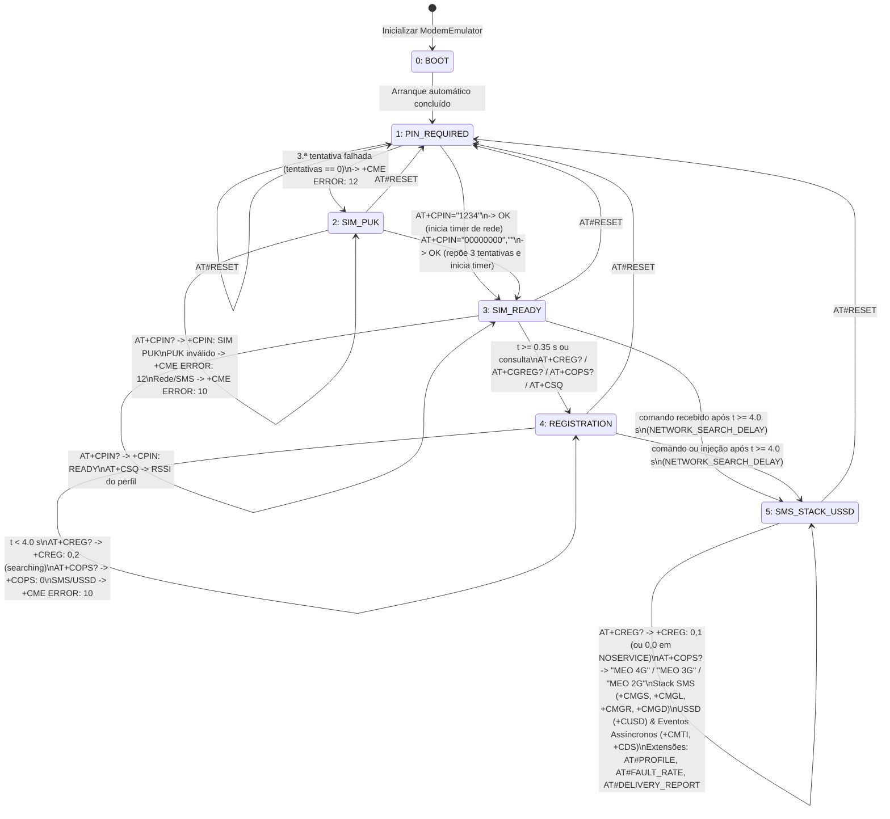
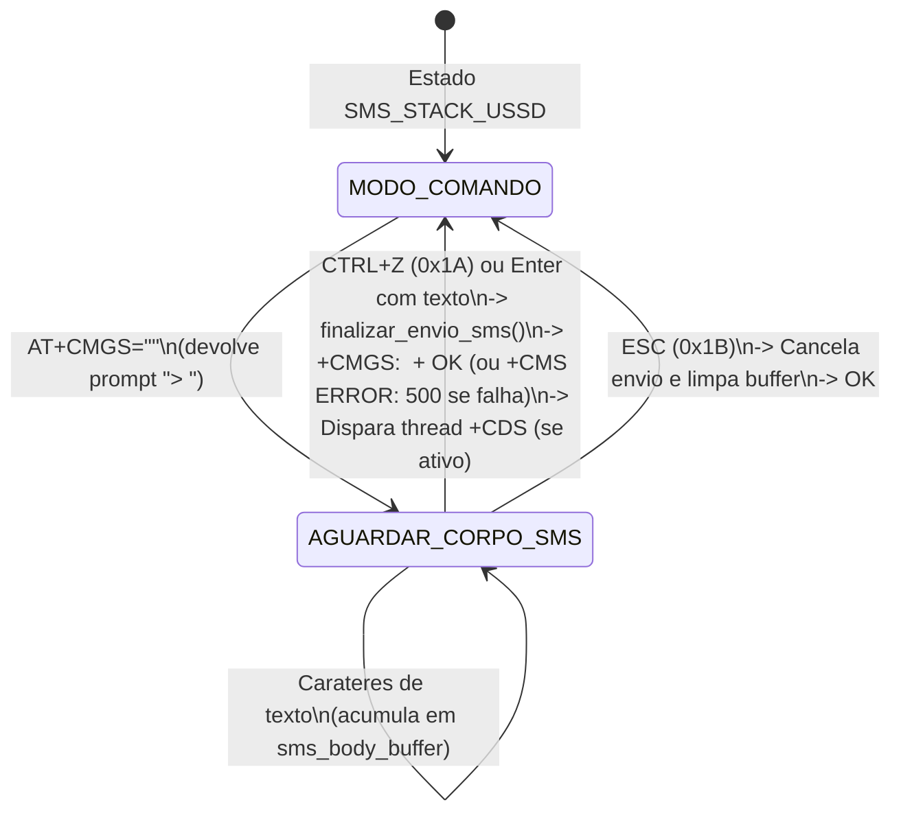

# Diagrama de Estados do Emulador de Modem AT (Semanas 1–7)

**Disciplina:** Redes e Serviços de Comunicações Móveis (RSCM) — 2026/2027  
**Instituição:** Universidade de Trás-os-Montes e Alto Douro (UTAD)  
**Ficheiro de implementação:** [`at_emulator.py`](file:///c:/Users/X1605/Desktop/Projeto%20Redes%20%231/at_emulator.py) (`class ModemState(Enum)`)

O diagrama visual em formato vetorial encontra-se em [`diagrama_estados.svg`](./diagrama_estados.svg).

---

## 1. Diagrama da Máquina de Estados (`ModemState`)

---

## 2. Sub-máquina de Envio Interativo de SMS (`waiting_for_sms_body`)

Dentro do estado `SMS_STACK_USSD`, o comando `AT+CMGS="<destino>"` ativa um sub-estado interativo de leitura de bytes na sessão (`waiting_for_sms_body = True`):

---

## 3. Tabela Resumo dos Estados e Comportamento

| Estado (`ModemState`) | Código | Resposta `AT+CPIN?` | Resposta `AT+CREG?` | Comandos de Rede (`+CSQ`, `+COPS?`) | Stack SMS e USSD (`+CMGS`, `+CMGR`, `+CUSD`) |
|:---|:---:|:---|:---|:---|:---|
| **`BOOT`** | `0` | — *(transita logo para `PIN_REQUIRED`)* | — | — | — |
| **`PIN_REQUIRED`** | `1` | `+CPIN: SIM PIN` | `+CME ERROR: 10` | `+CME ERROR: 10` | `+CME ERROR: 10` |
| **`SIM_PUK`** | `2` | `+CPIN: SIM PUK` | `+CME ERROR: 10` | `+CME ERROR: 10` | `+CME ERROR: 10` |
| **`SIM_READY`** | `3` | `+CPIN: READY` | `+CREG: 0,0` *(ou transita p/ `0,2`)* | Permitido (`+CSQ` devolve sinal; `+COPS: 0`) | `+CME ERROR: 10` |
| **`REGISTRATION`** | `4` | `+CPIN: READY` | `+CREG: 0,2` *(procura < 4 s)* | Permitido (`+CSQ` devolve sinal; `+COPS: 0`) | `+CME ERROR: 10` |
| **`SMS_STACK_USSD`** | `5` | `+CPIN: READY` | `+CREG: 0,1` *(ou `0,0` em `NOSERVICE`)* | Operador e RSSI conforme `AT#PROFILE` (`LTE`/`3G`/`2G`/`NOSERVICE`) | **Ativo** (Suporta SMS, USSD, `+CMTI`, `+CDS` e injeção de falhas) |

---

## 4. Notas Técnicas de Implementação

1. **Comandos Sempre Disponíveis (Independentes do Estado):**
   Os comandos básicos de configuração do terminal — `AT`, `ATE0`, `ATE1`, `ATI`, `AT+CMEE?/=`, `AT+CMGF?/=`, `AT+CSCA?/=`, `AT+CNMI?/=` e `AT#RESET` — são aceites em qualquer estado após o arranque.
2. **Temporização da Procura de Rede (`_atualizar_registo_rede`):**
   A transição `SIM_READY` $\rightarrow$ `REGISTRATION` $\rightarrow$ `SMS_STACK_USSD` é controlada pelo relógio interno (`self.network_search_start`) sem bloquear a thread principal. O método `_atualizar_registo_rede()` é invocado no início de `_executar_logica_comando()` e de `injetar_sms_recebido()`, garantindo que o modem passa para `REGISTRATION` após $0.35\text{ s}$ (ou na primeira consulta de rede) e para `SMS_STACK_USSD` assim que decorrem os $4.0\text{ s}$ definidos em `NETWORK_SEARCH_DELAY`.
3. **Efeito das Extensões (Semana 6) no Estado `SMS_STACK_USSD`:**
   - Se `network_profile == "NOSERVICE"`, o modem mantém-se no estado `SMS_STACK_USSD`, mas simula perda de cobertura: `AT+CREG?` responde `+CREG: 0,0`, `AT+CSQ` responde `99,99`, `AT+CMGS` falha com `+CMS ERROR: 330` e `AT+CUSD` falha com `+CME ERROR: 515`.
   - Se `fault_rate > 0.0`, o comando `AT+CMGS` pode falhar probabilisticamente com `+CMS ERROR: 500`, acionando a *Retry Policy* do `ModemClient`.
